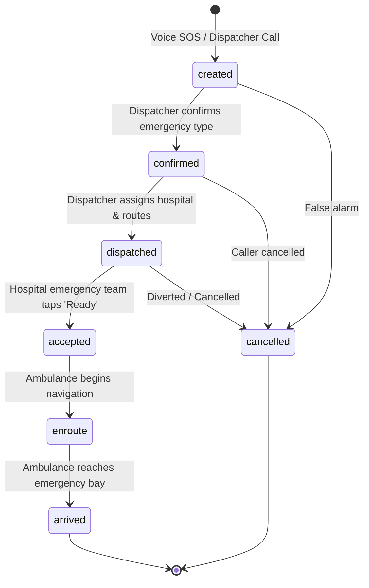

# GoldenHour — Intelligent Emergency Dispatch & Routing (Backend & Logic Layer)

GoldenHour ensures emergency dispatchers send critical patients to the nearest hospital that can **actually treat their emergency** (not just blindly rushing to the nearest hospital), and alerts the receiving emergency bay before the ambulance arrives.

---

## Architecture & Tech Stack

- **Runtime & Language**: Node.js (v20+) / ES Modules / JavaScript (React + Vite compatible)
- **Database & Realtime Sync**: Firebase Firestore (Modular SDK v9+)
- **Routing Engine**: Project OSRM Public Routing API (`https://router.project-osrm.org`) with an automatic Haversine + urban road factor (1.4x) fallback
- **Testing**: Vitest unit & integration test runner
- **Geographic Focus**: Bangalore, Karnataka, India

---

## Incident Status Lifecycle State Machine



### Transition Validation Matrix

| From Status | Permitted Next Statuses | Trigger / Role |
| :--- | :--- | :--- |
| `created` | `confirmed`, `cancelled` | Dispatcher confirms clinical category |
| `confirmed` | `dispatched`, `cancelled` | Dispatcher commits hospital selection |
| `dispatched` | `accepted`, `cancelled` | Hospital ER team acknowledges intake |
| `accepted` | `enroute` | Ambulance driver starts trip |
| `enroute` | `arrived` | Ambulance reaches hospital |
| `arrived` | *None (Terminal)* | Case closed |
| `cancelled` | *None (Terminal)* | Audit trail recorded |

Every state transition is executed inside an atomic **Firestore transaction** and appends an immutable audit log to `incidents/{id}/events`.

---

## Quick Start & Verification

### 1. Install Dependencies
```bash
npm install
```

### 2. Configure Firebase Environment
Copy the example environment configuration:
```bash
cp .env.example .env
```
Provide your Firebase project credentials in `.env` (`VITE_FIREBASE_*`).

### 3. Run Unit Tests (100% Passing)
```bash
npm test
```
Runs 37 automated tests across ranking, voice classification (multilingual & ambiguity), time saved, routing with fallback, incident lifecycle, and the end-to-end demo scenario.

### 4. Run the Terminal Demo Scenario
```bash
npm run demo
# or: node scripts/demo-cli.js
```
Executes the live Bangalore demo scenario (heart attack at Hebbal) and prints the AI voice classification, the "old way" failure analysis, the top 3 ranked hospitals, clinical exclusions, and minutes saved.

### 5. Seed / Reset Hospitals
```bash
npm run seed       # Idempotently batches 12 Bangalore hospitals to Firestore
npm run reset-demo # Restores bed counts and clears demo incident documents
```

---

## Backend API Documentation

### 1. Hospital Service (`src/services/hospitalService.js`)

#### `subscribeToHospitals(callback, errorCallback)`
- **Input**:
  - `callback(hospitals: Array<Hospital>)`: Invoked upon initial fetch and every realtime update.
  - `errorCallback(err: Error)` (optional).
- **Output**: `unsubscribe: Function`
- **Description**: Realtime Firestore listener tracking all hospital capacities, 24x7 statuses, and duty specialists.

#### `getHospital(id)`
- **Input**: `id: string` (Hospital doc ID)
- **Output**: `Promise<Hospital | null>`

#### `updateHospitalStatus(hospitalId, partialFields)`
- **Input**:
  - `hospitalId: string`
  - `partialFields: Object` — Only accepts:
    - `icu_beds_available: number` (integer >= 0)
    - `emergency_24x7: boolean`
    - `has_cath_lab: boolean`
    - `has_stroke_unit: boolean`
    - `has_trauma_center: boolean`
    - `has_maternity: boolean`
    - `has_burn_unit: boolean`
    - `has_blood_bank: boolean`
    - `specialists_on_duty: Array<string>`
- **Output**: `Promise<Object>`
- **Description**: Validates input schema strictly. Rejects unauthorized fields or out-of-bounds values with descriptive errors. Updates document with `updatedAt: serverTimestamp()`.

---

### 2. Incident Service (`src/services/incidentService.js`)

#### `createIncident({ source, transcript, suggestedType, emergencyType, patientLocation })`
- **Inputs**:
  - `source: 'voice' | 'dispatcher'`
  - `transcript: string`
  - `suggestedType: string | null`
  - `emergencyType: string | null`
  - `patientLocation: { lat: number, lng: number, label: string }`
- **Output**: `Promise<Incident>`
- **Initial Status**: `'created'`

#### `confirmIncident(id, emergencyType)`
- **Inputs**: `id: string`, `emergencyType: string`
- **Status Change**: `'created' -> 'confirmed'`

#### `dispatchIncident(id, { hospitalId, rankedSnapshot, etaMinutes, timeSaved })`
- **Inputs**:
  - `id: string`
  - `hospitalId: string`
  - `rankedSnapshot: Array<Object>` (Top 3 recommendations)
  - `etaMinutes: number`
  - `timeSaved: Object`
- **Status Change**: `'confirmed' -> 'dispatched'`

#### `hospitalAccept(id)`
- **Input**: `id: string`
- **Status Change**: `'dispatched' -> 'accepted'`

#### `startTrip(id, initialPosition)`
- **Inputs**: `id: string`, `initialPosition: { lat, lng }` (optional)
- **Status Change**: `'accepted' -> 'enroute'`

#### `markArrived(id)`
- **Input**: `id: string`
- **Status Change**: `'enroute' -> 'arrived'`

#### `cancelIncident(id, reason)`
- **Inputs**: `id: string`, `reason: string`
- **Status Change**: `('created' | 'confirmed' | 'dispatched') -> 'cancelled'`

#### Realtime Incident Subscriptions
- `subscribeToIncident(id, cb)`: Single incident doc listener.
- `subscribeToIncidentsByStatus(statuses[], cb)`: Filtered query listener.
- `subscribeToIncomingForHospital(hospitalId, cb)`: Filtered query for hospital triage screens (`dispatched`, `accepted`, `enroute`).

---

### 3. Ranking Engine (`src/services/rankingEngine.js`)

Pure, deterministic clinical decision engine with zero network side effects.

#### `rankHospitals({ emergencyType, patientLocation, hospitals, etaProvider })`
- **Inputs**:
  - `emergencyType: string` (`'heart_attack'`, `'stroke'`, `'trauma'`, `'pregnancy'`, `'burns'`)
  - `patientLocation: { lat: number, lng: number }`
  - `hospitals: Array<Hospital>`
  - `etaProvider(from, to): { etaMinutes: number, distanceKm: number }` (optional injected provider)
- **Output**:
  ```json
  {
    "recommended": [
      {
        "hospital": { "id": "aster-cmi-hospital", "name": "Aster CMI Hospital", "...": "..." },
        "etaMinutes": 7.1,
        "distanceKm": 2.1,
        "score": 5.6,
        "reasons": [
          "Cath Lab (Angioplasty) available",
          "5 ICU beds free",
          "Cardiologist on duty",
          "7.1 min away"
        ]
      }
    ],
    "excluded": [
      {
        "hospital": { "name": "Columbia Asia Hospital Hebbal" },
        "distanceKm": 0.67,
        "etaMinutes": 2.3,
        "reason": "No cath lab"
      },
      {
        "hospital": { "name": "Apollo Hospitals" },
        "reason": "ICU full (0 beds)"
      }
    ],
    "nearestOverall": {
      "hospital": { "name": "Columbia Asia Hospital Hebbal" },
      "distanceKm": 0.67,
      "etaMinutes": 2.3,
      "canTreat": false,
      "reason": "No cath lab"
    }
  }
  ```
- **Scoring Formula**:
  $$\text{Score} = (\text{ETA} \times 1.0) + (\text{ICU Beds} == 1 \,?\, +2.0 : 0) - (\text{Specialist On Duty} \,?\, 1.5 : 0)$$
  *Lower score is ranked higher. Tie-breaks resolved by ETA.*

---

### 4. Routing Service (`src/services/routingService.js`)

#### `getRoute(from, to)`
- **Inputs**: `from: { lat, lng }`, `to: { lat, lng }`
- **Output**:
  ```json
  {
    "etaMinutes": 7.1,
    "distanceKm": 2.1,
    "geometry": [[13.0358, 77.5970], [13.0380, 77.5960], "..."],
    "source": "osrm"
  }
  ```
- **Resilience**: 4-second timeout on Project OSRM public API. Automatically falls back to Haversine with a 1.4x urban curvature factor at 25 km/h (`source: 'fallback'`). In-memory cache keyed by 4-decimal place rounded coordinates. Never throws.

#### `getEtasForMany(from, hospitals)`
- **Inputs**: `from: { lat, lng }`, `hospitals: Array<Hospital>`
- **Output**: `Promise<Array<RouteResult>>`
- **Concurrency**: Governed by worker queue (`ROUTING_CONFIG.CONCURRENCY_LIMIT = 5`).

---

### 5. Multilingual Voice Classifier (`src/services/voiceClassifier.js`)

#### `classifyEmergency(transcript)`
- **Input**: `transcript: string`
- **Output**:
  ```json
  {
    "type": "heart_attack",
    "confidence": 0.91,
    "matchedKeywords": ["chest pain", "left arm pain"],
    "needsHumanReview": true
  }
  ```
- **Languages Supported**:
  - English
  - Hindi (Romanized & Devanagari script)
  - Kannada (Romanized & Kannada script)
- **Ambiguous Inputs**: Maps phrases like `"can't breathe"` or `"unconscious"` to `'heart_attack'` with low confidence (0.35 - 0.40). Empty/unmatched queries return `'unknown'` (confidence 0).

---

### 6. Time Saved Service (`src/services/timeSavedService.js`)

#### `calculateTimeSaved({ nearestEta, recommendedEta, etaNearestToRecommended, transferDelayMinutes, nearestCanTreat })`
- **Inputs**:
  - `nearestEta: number` (drive minutes to nearest facility)
  - `recommendedEta: number` (drive minutes directly to capable hospital)
  - `etaNearestToRecommended: number` (inter-hospital transfer drive minutes)
  - `transferDelayMinutes: number` (default: 10 minutes)
  - `nearestCanTreat: boolean`
- **Output**:
  ```json
  {
    "oldWayMinutes": 19.3,
    "newWayMinutes": 7.1,
    "savedMinutes": 12.2,
    "assumptions": {
      "nearestCanTreat": false,
      "transferDelayMinutes": 10,
      "isTransferDelayAssumed": true,
      "note": "The 10-minute inter-hospital transfer delay is a conservative clinical assumption covering ER triage, bed rejection, and re-dispatch, not empirical live sensor data."
    }
  }
  ```
- **Honesty Principle**: If `nearestCanTreat === true`, `savedMinutes = 0` is reported honestly without inflating metrics.

---

### 7. Ambulance Simulator (`src/services/ambulanceSimulator.js`)

#### `startSimulation(incidentId, routeGeometry, speedMultiplier, options)`
- Broadcasts virtual ambulance GPS coordinates to Firestore incident document every 2 seconds.
- Automatically transitions incident state to `'arrived'` upon reaching destination.
- Returns `{ stop: () => stopSimulation(incidentId) }`.

#### `stopSimulation(incidentId)`
- Aborts active timer and removes simulator instance from active memory.

---

### 8. Demo Helper (`src/services/demoService.js`)

#### `runDemoScenario(options)`
- Runs the complete Bangalore demo:
  - Caller location: Hebbal (`13.0358, 77.5970`)
  - Voice audio transcript
  - AI Voice classification
  - Clinical hospital ranking
  - Realtime OSRM route calculations
  - Time saved analysis
- Used directly by `scripts/demo-cli.js` and automated tests.

---

## Frontend Application

### Tech Stack & Architecture
- **Framework**: React 19 + Vite 6 (JavaScript)
- **Routing**: `react-router-dom` v7 with code-split lazy loading
- **Map System**: Leaflet + `react-leaflet` with OpenStreetMap / CartoDB tiles (zero API keys required)
- **Design System**: Calm Control Room tokens using CSS variables, custom themes (Dark & Light), zero heavy UI frameworks
- **Realtime Layer**: Native Firebase Firestore modular subscriptions with automatic cleanup and heartbeat indicators

### How to Run the Frontend
```bash
# 1. Install dependencies
npm install

# 2. Start Vite development server
npm run dev

# 3. Open browser at http://localhost:5173
```

### Route Directory
| Route | Role / Screen | Smart Default Theme | Description |
| :--- | :--- | :--- | :--- |
| `/` | Landing / Demo Launcher | Dark | Hero comparison (old vs GoldenHour), role launcher cards, and one-click demo triggers |
| `/dispatcher` | Dispatcher Command Center | Dark | 3-column triage hub with live map, clinical filter cards, OSRM road routes, and dispatch flow |
| `/hospital` | Hospital ER Desk | Light | Pre-arrival trauma alerts with circular countdown, bay readiness confirmation, and ICU bed stepper |
| `/driver` | Ambulance Driver Unit | Follows Device | Glance-and-go navigation, giant Google Maps directions trigger, and live GPS broadcast |
| `/sos` | Patient Voice SOS | Follows Device | Calming voice intake (Web Speech API) supporting English, Hindi, and Kannada, with manual fallback |

### Design System & Theme Engine
- **Themes**: High-contrast Dark (Navy/Charcoal `#0b0f19`) and Light (`#f8fafc`).
- **Accent**: Gold / Amber (`#f59e0b` in dark, `#b45309` in light) meeting strict WCAG AA contrast (4.5:1+).
- **Semantics**: Red strictly reserved for critical clinical alerts; Green for verified capability / ready bays; Grey for full capacity.
- **Smart Defaults**: Screen defaults (Dispatcher: Dark, Hospital: Light, Landing: Dark, Driver/SOS: Device) remember explicit user overrides in `localStorage`.
- **Map Tile Synchronicity**: Map tiles switch to CartoDB Dark Matter in dark mode and CartoDB Voyager in light mode.

### 3-Minute Live Demo Script (For Judges)
1. **0:00 - The Problem (Landing Page `/`)**:
   - Open `/`. Explain: *"In acute emergencies like STEMI heart attacks, standard GPS blindly sends ambulances to the nearest hospital. If that hospital has no Cath Lab or 0 ICU beds, an inter-hospital transfer adds 12 to 20 minutes of fatal delay."*
   - Point out the side-by-side comparison.
2. **0:45 - Launching the Hebbal Heart Attack Demo**:
   - Click **"Start Hebbal Demo"**. The app creates an emergency incident in Firestore at Hebbal (`13.0358, 77.5970`) and routes directly into `/dispatcher`.
3. **1:15 - Dispatcher Command Center (`/dispatcher`)**:
   - Show the Left column: Voice AI suggestion (`heart_attack`) labeled *"Needs dispatcher confirmation"*.
   - Show the Center map: Baptist Hospital is geographically nearest (2.2 km) but highlighted with a warning badge: **"Nearest: Cannot Treat (No cath lab)"**. Apollo Bannerghatta and Mallya are excluded for full ICUs.
   - Show the Right column: **Ramaiah Memorial Hospital** is ranked #1 recommended with 7.5 min road ETA via OSRM, Cath Lab verified, and 5 ICU beds free.
   - Show the **Time Saved Bar**: Direct route saves **+11.5 minutes** vs default triage.
   - Click **"Dispatch Here"** -> Confirm.
4. **2:15 - Hospital Pre-arrival & Realtime Capacity (`/hospital`)**:
   - Switch to `/hospital` tab (set to Ramaiah Memorial). Show the pulsing **INCOMING TRAUMA** alert banner with the Golden-hour countdown ring.
   - Click **"Ready — Prepare Bay"**. Status instantly synchronizes across all screens.
   - Change Ramaiah's ICU beds from 5 to 0 using the stepper. Explain how Firestore propagates the change in under 10ms.
5. **2:45 - Ambulance Response (`/driver`)**:
   - Switch to `/driver`. Show the giant destination card, 1-tap Google Maps directions link, and click **"Start Trip & Broadcast GPS"** to demonstrate live route traversal.

### Known Limitations & Ethical Guardrails
- **Simulated Facility Data**: Hospital names and geographic coordinates are real Bangalore locations; bed availability, specialist rosters, and capability flags are sample demo fixtures.
- **Traffic Modeling**: OSRM routes represent free-flow road transit times; live congestion data requires commercial enterprise telematics.
- **Clinical AI Disclaimer**: Voice classification is an advisory triage aid, not a diagnostic medical device. Human dispatcher confirmation is strictly enforced in the lifecycle.

---

## Roles and Access Control (RBAC)

GoldenHour implements end-to-end Role-Based Access Control enforcing least privilege across both the frontend React client and the backend Firestore security rules.

### Portal Access Matrix

| Route | Allowed Role | Authentication | Description |
| :--- | :--- | :--- | :--- |
| `/` | Public (All) | None | Landing hero, comparative problem explainer, and system portal launcher. |
| `/sos` | Public (All) | None | Emergency patient voice & manual SOS. A citizen experiencing an emergency is never blocked by login. Can create incidents (`created` status only). |
| `/login` | Public (All) | None | Authentication page with email/password form and 1-click demo login buttons. |
| `/dispatcher` | `dispatcher`, `admin` | Required | Command triage room: incident confirmation, map overview, hospital recommendations, and dispatch triggers. |
| `/hospital` | `hospital`, `admin` | Required | Emergency Receiving Desk: strictly bound to the authenticated facility (`hospitalId`). Dropdown selection is disabled; only incoming alerts and capacity status for that specific hospital are accessible. |
| `/driver` | `driver`, `admin` | Required | Ambulance driver dashboard: active assignment details, GPS tracking, and trip simulator. |

> **Note on Demo Accounts & Quick-Login Buttons**:  
> The demo accounts panel and 1-click login buttons on `/login` are provided solely for rapid hackathon review and judging demonstrations. In production, credentials would be securely provisioned via an enterprise identity provider (SSO) and would not be publicly exposed in the client UI.

### Demo Credentials & Hospital Bindings

All demo accounts share the password configured in `VITE_DEMO_PASSWORD` in `.env` (default: `goldenhour2026!`).

| Account Email | Role | Bound Hospital ID | Bound Facility Name |
| :--- | :--- | :--- | :--- |
| `dispatcher@goldenhour.demo` | `dispatcher` | — | Central Dispatch Authority |
| `driver@goldenhour.demo` | `driver` | — | Rapid Response Ambulance Unit |
| `ramaiah@goldenhour.demo` | `hospital` | `H23` | Ramaiah Memorial Hospital |
| `fortis.cunningham@goldenhour.demo` | `hospital` | `H08` | Fortis Hospital (Cunningham Road) |
| `aster@goldenhour.demo` | `hospital` | `H11` | Aster CMI Hospital |
| `admin@goldenhour.demo` | `admin` | — | System Maintenance & Test Scripts |


